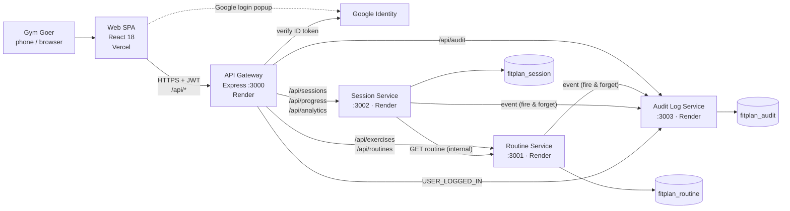
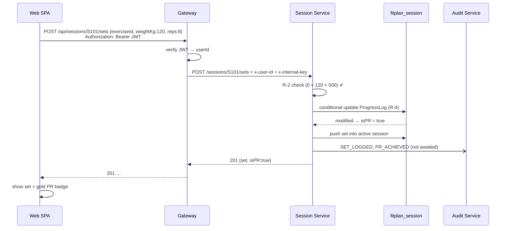
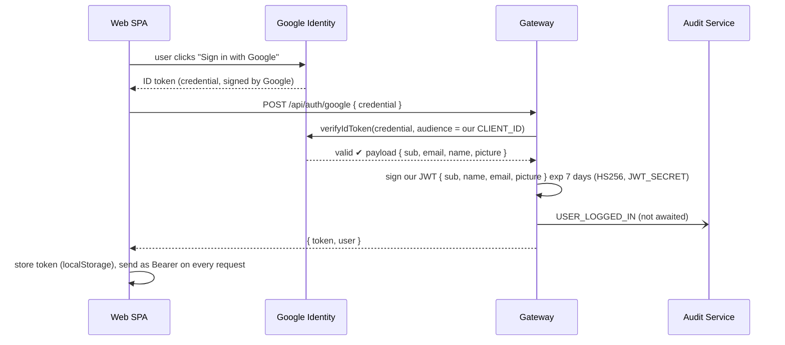
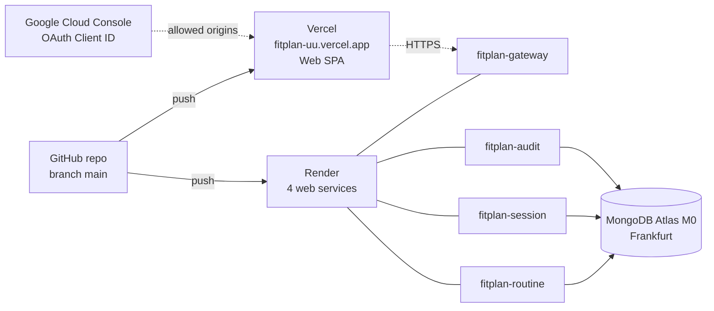

# FitPlan — Technical Design Document

> **Version:** 2.6 · **Date:** 07.11.2026 · **Sprint:** 1 (26.10.–22.11.2026)
> **Team:** Jakub Kalina (Lead Developer — backend & frontend) · Ran Regev (Lead Analyst) · Vitalik Holoienko (QA Tester, since 04.11.2026)
> **Companion documents:** *FitPlan Code Map* lists every file of the application (what it contains and why); *FitPlan UI/UX Guide* shows every screen, the colour palette and the mobile-first rules.
> **Rule:** If code ever disagrees with these two documents, either the code is wrong or the document is updated first. Nothing is implemented that is not described here.

---

## 0. How to read this document

| Section | Answers the question |
|---|---|
| 1. Goals, constraints & approach | What must the system do, what limits us, how do we develop it? |
| 2. Tech stack | Which technologies, which versions, and **why each one** |
| 3. Architecture overview | Which parts exist and how they talk to each other |
| 4. Frontend (React SPA) | Pages, state, design, how it calls the backend, where it is hosted |
| 5. API Gateway | The single entry point: login, JWT, routing, security, hosting |
| 6. Backend microservices | Routine, Session and Audit Log service — what each one owns and does |
| 7. Data model | What is stored where, field by field |
| 8. Business rules in code | Exactly how R-1 … R-4 are enforced |
| 9. API contract | Every endpoint, request, response, error |
| 10. Hosting & deployment | Vercel, Render, MongoDB Atlas, Google Cloud — configuration and why |
| 11. Security summary | Every protection in one table |
| 12. Testing | Who tests what, with which tool, when |
| 13. Sprint mapping | What is built when and by whom |
| 14. Out of scope | What we deliberately do **not** build |
| 15. Decision log | Key technical decisions and why they were made |

---

## 1. Goals, constraints & approach

**Functional goals** (from the 4 user stories):

| US | Feature | Entities | Rules |
|---|---|---|---|
| US1 | Create / edit / delete workout routine templates from an exercise catalog | Exercise, WorkoutRoutine | R-1 |
| US2 | Start a workout, log sets live, detect PRs instantly, finish workout | WorkoutSession, ProgressLog | R-2, R-3, R-4 |
| US3 | Progress charts per exercise + PR summary | WorkoutSession, ProgressLog | – |
| US4 | Browse history of completed workouts + session detail | WorkoutSession | – |

**Non-functional goals:**
- **Set logging in < 3 seconds** from finishing a set to seeing it saved (mostly a UI problem, see §4.5).
- Mobile-first UI (used on a phone in the gym), works on desktop too.
- Public HTTPS deployment.

**Assignment constraints (BPMI, non-negotiable):**
- Exactly 4 business entities (User/Role not counted): `Exercise`, `WorkoutRoutine`, `WorkoutSession`, `ProgressLog`.
- Microservices backend behind an API gateway (Node.js + Express + MongoDB).
- React 18 SPA.
- 3rd-party login (Google OAuth 2.0) + JWT.
- **Dedicated Audit Log service** → a *Must have*, not optional.

**Team constraints:**
- 3 students (Vitalik joined on 04.11.2026) → **every technology must be explainable by the team**, above all by Jakub and Ran at the consultation. We prefer fewer libraries and built-in features over "clever" tooling.
- Roles: **Jakub** writes all code (backend + frontend, deployment). **Ran** owns requirements/analysis, documents and the exercise data. **Vitalik** owns quality assurance: test scenarios, API verification (Postman), manual testing and defect reports. The Project Manager rotates and presents his sprint at the consultation (Project preparation Ran, Sprint 1 Jakub, Sprint 2 Vitalik; Sprint 3 has no consultation, the whole team finishes the MVP and the final video; see project plan).

### 1.1 Development approach — hybrid: incremental data foundation + iterative features

| Part | Style | Why |
|---|---|---|
| **Data layer** (all Mongoose schemas, indexes, validators for all 4 entities + audit event, exercise seed) | **Incremental / plan-driven ("waterfall-like")** — designed completely in this document and implemented **in full in Sprint 1** | Every feature depends on the data model. Changing schemas later causes rework. The model is stable because the 4 entities and 4 rules are already fixed by analysis. |
| **Features** (API endpoints + UI per user story) | **Iterative (agile)** — one vertical slice per sprint, demo, feedback, adjust backlog | We always have a working, demonstrable app; teacher feedback after each demo can change the next sprint without breaking the foundation. |

Delivery order (each sprint ends with a working demo from the user's perspective):
- **Sprint 1 (demo 23.11.):** Google login, exercise catalog, routine templates (US1) — on top of the complete data layer.
- **Sprint 2 (demo 14.12.):** live workout + set logging + PR detection (US2), workout history (US4).
- **Sprint 3 (video, January 2027):** progress analytics (US3), audit log, final deployment & E2E tests.

### 1.2 Units & input precision
- Weight is always in **kilograms, whole numbers only — smallest step is 1 kg** (no 0.25 / 0.5 / 1.25 kg plates). Keeps input fast and the rules simple.
- Reps are whole numbers.

### 1.3 Every sprint ships a working app
Rule: **what is not built yet is not visible.** The app never shows a button, tab or page that does nothing. Each sprint only *adds*; nothing from an earlier sprint is rewritten, because the data layer is complete from Sprint 1.

| Part of the app | Sprint 1 (demo 23.11.) | Sprint 2 (demo 14.12.) | Sprint 3 (final) |
|---|---|---|---|
| Bottom tab bar | Routines | + Workout, History | + Progress |
| Routine card actions | Edit, Delete | + Start workout | – |
| Web routes | `/login`, `/routines`, `/routines/new`, `/routines/:id/edit` | + `/workout`, `/history`, `/history/:id` | + `/progress` |
| Gateway routing table | exercises, routines | + sessions, progress | + analytics, audit |
| Deployed services | gateway, routine | + session | + audit |
| Audit events | off (no `AUDIT_URL` → the client does nothing) | off | on |
| Data layer (schemas, indexes, validators) | **complete for all entities** | – | – |

How it is done in code: the tab list (`NavBar.jsx`), the routes (`App.jsx`) and the gateway table (`serviceProxy.js`) each grow by one line per new feature. There are no feature flags and no hidden half-finished screens.

---

## 2. Tech stack

### 2.1 Overview

| Layer | Technology | Version | Why this and not something else |
|---|---|---|---|
| Language | **JavaScript (ES Modules)** | ES2022+ | One language for frontend and backend. TypeScript would add a compile step and a learning curve; for a 4-entity MVP plain JS + Mongoose schemas give enough structure. |
| Runtime | **Node.js** | **24 LTS** | Node 20 reached end-of-life in April 2026 (no security fixes). Node 24 is the supported LTS line and has built-in `--watch` (replaces nodemon) and `--env-file` (replaces dotenv) → 2 fewer dependencies. |
| Package manager | **npm workspaces** | bundled with Node | One repository, 6 packages (web, gateway, 3 services, shared) installed with one `npm install`. No extra tool to learn. |
| Backend framework | **Express** | 5.x | Required by assignment. v5 forwards errors thrown in `async` handlers to the error middleware automatically → no try/catch in every controller. |
| Database | **MongoDB Atlas** (free M0 cluster) | 8.x | Required by assignment. Hosted MongoDB: no installation, same database reachable from our laptops and from the cloud. |
| ODM | **Mongoose** | 8.x | Schemas, validators and indexes written in code. Rules R-1 and R-2 live partly in the schema. |
| Gateway proxy | **http-proxy-middleware** | 3.x | Forwards `/api/routines/*` etc. to the right service with a few lines of configuration. |
| Auth | **google-auth-library** + **jsonwebtoken** | latest | Official Google library verifies the Google ID token; `jsonwebtoken` signs and verifies our own JWT. |
| Security middleware | **helmet**, **cors**, **express-rate-limit** | latest | Security HTTP headers, allowed browser origin, protection against request flooding. |
| Frontend | **React** | **18.3.x (pinned)** | Required by assignment. `npm create vite` installs React 19 by default → we **pin 18.3**. |
| Build tool | **Vite** | 6.x | Fast dev server, simple config, dev proxy to the gateway (no CORS trouble locally). Create React App is deprecated. |
| Routing | **React Router** | 6.x | Simple `<Routes>` API, matches the blueprint. |
| Google login button | **@react-oauth/google** | latest | Thin wrapper around Google Identity Services; gives us the ID token ("credential"). |
| Styling | **Plain CSS + CSS Modules + CSS variables** | – | Design tokens from the blueprint become CSS variables. No Tailwind/UI kit → nothing to explain except CSS. |
| Charts | **Hand-written SVG** | – | A line chart is ~60 lines of code and we can explain every coordinate. No chart library. |
| Tests | **Vitest**, **Supertest**, **mongodb-memory-server**, **React Testing Library**; **Playwright** (E2E) | latest | One test runner for frontend and backend; Supertest calls Express without a real server; in-memory MongoDB → tests never touch Atlas. |
| Code quality | **ESLint** + **Prettier** | latest | Same formatting everywhere → clean diffs. |
| Hosting | **Vercel** (frontend) · **Render** (gateway + 3 services) · **MongoDB Atlas** (database) | free tiers | HTTPS automatic, deploy from GitHub, no cost (§10). |
| Project tracking | **Google Sheets** | – | Our chosen tracking tool: capacity plan, PBS/WBS per sprint, backlogs, estimate vs. actual hours. |

### 2.2 What we intentionally do **not** use (and why)
- **No Redux / React Query** – React Context + small custom hooks are enough for 7 pages.
- **No Docker / Kubernetes** – Render runs Node directly; Docker would be one more thing to explain without benefit for the MVP.
- **No message broker (Kafka, RabbitMQ)** for the audit log – a fire-and-forget HTTP call is enough (§6.4). Named as a future improvement.
- **No validation library (Joi/Zod)** – Mongoose validators + a few explicit checks in the business layer.

---

## 3. Architecture overview

### 3.1 System diagram



All three databases live in **one** MongoDB Atlas cluster but are **separate databases** (database-per-service pattern). A service never reads another service's database – it asks the other service over HTTP.

### 3.2 The five deployable parts

| Part | Runs on | Owns data | Responsibility | Does NOT do |
|---|---|---|---|---|
| **Web SPA** (§4) | Vercel | – | All screens; calls `/api/*` only | Never talks to services directly |
| **API Gateway** (§5) | Render | – (no database) | Google login, issue/verify JWT, CORS, rate limiting, routing, adds user identity | Business logic, database access |
| **Routine Service** (§6.2) | Render | `Exercise`, `WorkoutRoutine` | Exercise catalog (read-only, seeded), routine CRUD, **R-1** | Sessions, PRs |
| **Session Service** (§6.3) | Render | `WorkoutSession`, `ProgressLog` | Start/log/finish/discard workout, **R-2, R-3, R-4**, history, analytics | Routine editing |
| **Audit Log Service** (§6.4) | Render | `AuditEvent` (technical) | Store immutable events, list them | Update/delete anything (by design) |

**Why 3 services and not 5 (separate History, Analytics)?** History (US4) and Analytics (US3) read the *same* `WorkoutSession` data as US2. Splitting them would force duplicating data between databases. Our rule: **one service = one set of data it owns.** "Analytics" and "Session History" from the user-story diagrams are *modules inside the Session Service* (separate route/logic files), not separate deployments.

### 3.3 How the parts communicate

| From → To | Protocol | Authentication | Example |
|---|---|---|---|
| Browser → Web SPA | HTTPS (static files) | – | load `https://fitplan-uu.vercel.app` |
| Web SPA → Gateway | HTTPS, JSON | `Authorization: Bearer <our JWT>` | `POST /api/routines` |
| Gateway → service | HTTPS, JSON (proxied) | `x-internal-key` + `x-user-id` | `POST /routines` |
| Session → Routine | HTTPS, JSON | `x-internal-key` + `x-user-id` | `GET /routines/:id` when starting a workout |
| Any → Audit | HTTPS, JSON, not awaited | `x-internal-key` | `POST /events` |
| Service → MongoDB | MongoDB driver (TLS) | DB user + password in connection string | `fitplan_session.sessions` |

### 3.4 Request flow example — logging a set (US2)



### 3.5 Code organisation (summary)
One Git repository (monorepo, branch `main` only, only Jakub pushes):

```
fitplan/
├── apps/web/            ← React SPA                      → Vercel
├── services/gateway/    ← API Gateway                    → Render  :3000
├── services/routine/    ← Exercise + WorkoutRoutine      → Render  :3001
├── services/session/    ← WorkoutSession + ProgressLog   → Render  :3002
├── services/audit/      ← AuditEvent                     → Render  :3003
├── packages/shared/     ← small code reused by all backend parts (not deployed alone)
├── e2e/                 ← Playwright end-to-end tests
└── render.yaml          ← infrastructure as code for all 4 Render services
```

Every backend service uses the same 4 layers, mirroring uuApp terminology taught in the course:

| Layer | uuApp term | Responsibility | Changes when… |
|---|---|---|---|
| `routes/` | – | URL → controller mapping | a URL changes |
| `controllers/` | API (command) | read the HTTP request, call ABL, choose status code | the HTTP response changes |
| `abl/` | ABL | **business rules** (R-1…R-4), ownership checks, audit events; knows nothing about HTTP | a rule changes |
| `dao/` | DAO | the **only** place that queries MongoDB | a query/database changes |
| `models/` | – | Mongoose schemas: fields, validators, indexes | the data model changes |

The complete list of files, with the purpose of each, is in **`CODE_BLUEPRINT.md`**.

---

## 4. Frontend — React SPA (`apps/web`)

### 4.1 Technology & structure
React 18.3 + Vite 6 + React Router 6, plain CSS Modules. One-way dependency rule:

```
pages  →  hooks  →  api  →  client.js  →  fetch()
  ↓
components (presentational, no fetch)
```
Only `src/api/` calls the backend. When an endpoint changes, we edit one folder.

### 4.2 Routes (pages)
| Path | Page | US |
|---|---|---|
| `/login` | LoginPage (Google button) | – |
| `/routines` | RoutinesPage – list + "Create routine" + "Start workout" | US1 |
| `/routines/new`, `/routines/:id/edit` | RoutineEditorPage | US1 |
| `/workout` | WorkoutPage – the active workout | US2 |
| `/history` | HistoryPage | US4 |
| `/history/:id` | SessionDetailPage | US4 |
| `/progress` | ProgressPage (chart + PR grid) | US3 |
| `*` | NotFoundPage | – |

All except `/login` are wrapped in `<ProtectedRoute>` (redirects to `/login` without a token). On mobile the navigation is a bottom tab bar: Routines · Workout · History · Progress.

### 4.3 State management
- **Server data** (routines, sessions…) lives in custom hooks (`useState` + `useEffect`) and is re-fetched after a change.
- **Global state** = only the logged-in user and token (`AuthContext`).
- **Active workout** state in `useActiveSession` (session + pre-filled input values).

### 4.4 Design system
Blueprint design tokens 1:1 as CSS variables in `tokens.css` (`--bg-primary: #0F172A`, `--accent-blue: #2563EB`, `--pr-gold: #F59E0B`, …). Dark theme, touch targets ≥ 44 px.
**Logo:** a barbell loaded with ever heavier plates, the heaviest one gold (= the new personal record); `public/favicon.svg`, also on the login page and in the side bar. Rules for its use: UI/UX Guide §2.

### 4.5 How we hit "< 3 s per set"
1. Weight and reps **pre-filled** with the previous set (or the routine target) → most sets need 0–1 changes.
2. `inputmode="numeric"` → the phone shows a number keypad immediately; whole kg only, so no decimal point.
3. Stepper buttons **−5 / −1 / +1 / +5 kg** and **−1 / +1 rep** for one-tap adjustments.
4. One big **"Log set"** button; the set appears instantly as *saving…*, the PR badge appears when the server answers (~100–300 ms when the services are awake).
5. No page navigation during a workout – everything on one screen.

### 4.6 SVG progress chart (US3)
Points `{date, topWeightKg}` → X spaced evenly per session, Y scaled linearly between min and max weight with 10 % padding → `<polyline>` + `<circle>` per point + axis labels. PR points drawn in gold. No chart library.

### 4.7 Talking to the backend
- `VITE_API_URL` = gateway URL (empty locally → Vite dev proxy forwards `/api` to `http://localhost:3000`).
- `client.js` adds `Authorization: Bearer <token>`, parses JSON, turns error responses into an `ApiError { status, code, message }`, and on `401` logs the user out.
- Error codes from the server (e.g. `SET_WEIGHT_OUT_OF_RANGE`) are mapped to friendly texts in one place (`utils/errorMessages.js`).
- After a routine is created, updated or deleted the user sees a short green confirmation (`ui/SuccessMessage.jsx`, closes itself after 4 s), as US1 requires. It is separate from the audit log, which records the same actions on the server from Sprint 3.

### 4.8 Hosting — Vercel
| Setting | Value |
|---|---|
| Project root directory | `apps/web` |
| Framework preset | Vite (build `npm run build`, output `dist/`) |
| Env variables | `VITE_API_URL=https://fitplan-gateway.onrender.com`, `VITE_GOOGLE_CLIENT_ID=…` |
| SPA routing | `vercel.json` rewrites every path to `/index.html`, so reloading `/history/123` works |
| Deploy | automatic on every push to `main`; HTTPS certificate automatic |

**Why Vercel for the frontend?** The SPA is only static files (HTML/JS/CSS). Vercel serves them from a global CDN for free, detects Vite automatically, and needs no server. The backend cannot run on Vercel the same way (see §10.5).

---

## 5. API Gateway (`services/gateway`)

### 5.1 Responsibilities
1. **Login:** verify the Google ID token, issue our own JWT (§5.3).
2. **Authentication:** verify our JWT on every `/api/*` request (except login and health).
3. **Routing:** forward the request to the correct service (§5.2).
4. **Identity forwarding:** add `x-user-id` (from the JWT) and `x-internal-key`; remove the `Authorization` header (services don't need it).
5. **Edge security:** CORS (only our frontend origin), helmet headers, rate limiting.
6. **Health / warm-up:** `GET /api/health/services` pings all services (§10.6).

The gateway has **no database and no business logic**.

### 5.2 Routing table

| Public path (browser) | Target service | Path at the service |
|---|---|---|
| `/api/exercises/*` | Routine `ROUTINE_URL` | `/exercises/*` |
| `/api/routines/*` | Routine `ROUTINE_URL` | `/routines/*` |
| `/api/sessions/*` | Session `SESSION_URL` | `/sessions/*` |
| `/api/progress/*` | Session `SESSION_URL` | `/progress/*` |
| `/api/analytics/*` | Session `SESSION_URL` | `/analytics/*` |
| `/api/audit` | Audit `AUDIT_URL` | `/audit` (read own events) |
| *(not routed)* | Audit | `/events` – internal only, unreachable from the browser |

Rule: the gateway strips the `/api` prefix. Anything not in the table returns `404`.

### 5.3 Authentication (Google OAuth 2.0 → our JWT)



- **Why our own JWT instead of Google's token everywhere?** Google ID tokens expire after 1 hour and are meant for *sign-in*, not as an API session. Our JWT has our own expiry and claims, and the services never depend on Google.
- **Why only the gateway verifies the JWT?** One place for security logic. Services trust `x-user-id` only together with the correct `x-internal-key` (§6.1).
- **Why localStorage and not a cookie?** Frontend (vercel.app) and gateway (onrender.com) are different sites; browsers increasingly block cross-site cookies. Trade-off: JavaScript can read localStorage, so an XSS bug could steal the token. Mitigations: React escapes output by default, we never use `dangerouslySetInnerHTML`, helmet headers, 7-day expiry.
- **No User collection:** identity comes from Google; `userId` = Google `sub`. Minimal personal data stored (GDPR-friendly).

### 5.4 Middleware order (matters!)
```
helmet → cors → express.json (only for /api/auth) → rate limiter
  → /api/health, /api/auth/*         (public)
  → requireAuth                      (everything below needs a valid JWT)
  → proxy table (§5.2)
  → 404 → error handler
```
`express.json` is **not** applied before the proxy – the proxy streams the original body to the service.

### 5.5 Rate limits
- General: 300 requests / 15 min per IP.
- `/api/auth/*`: 20 requests / 15 min per IP (login flooding).
- Exceeding → `429 { code: "RATE_LIMITED" }`. Render sits behind a proxy, so `app.set("trust proxy", 1)` is needed to see the real client IP.

### 5.6 Hosting
Render web service `fitplan-gateway` (§10.2). It is the **only backend URL the frontend knows**.

---

## 6. Backend microservices

### 6.1 What every service has in common
- **Same 4 layers** (§3.5) and the same files `server.js` (start), `app.js` (build Express app, exported for tests), `config.js` (read & validate env vars), `db.js` (connect to its own database).
- **Internal authentication:** every request must carry `x-internal-key` equal to `INTERNAL_KEY`, otherwise `401`. Shared middleware from `packages/shared`.
- **User scoping:** every DAO query filters by `userId` taken from `x-user-id` → a user can only ever see their own data; another user's id gives `404`.
- **Uniform error JSON** from a shared error handler (§9.1). Mongoose `ValidationError` → `400`, duplicate key `E11000` → `409`.
- **Health endpoint** `GET /health` → `{ status: "ok", db: "up" }` (no auth, used by Render and the warm-up).

### 6.2 Routine Service (`services/routine`, :3001)
| | |
|---|---|
| **Owns** | `Exercise` (catalog), `WorkoutRoutine` (templates) – database `fitplan_routine` |
| **Rules** | **R-1** (1–15 exercises), routine name 1–60 chars, each `exerciseId` must exist in the catalog |
| **Endpoints** | `GET /exercises`, `GET /exercises/:id`, `GET/POST /routines`, `GET/PUT/DELETE /routines/:id` |
| **Calls** | Audit (`ROUTINE_CREATED/UPDATED/DELETED`) |
| **Called by** | Gateway; Session Service (`GET /routines/:id` when a workout starts) |
| **Seed** | `npm run seed` inserts ~40 exercises from `seed/exercises.json` (idempotent upsert by name) |

When a routine is saved, the ABL looks up each exercise and stores a **copy of its name** (`exerciseName`) in the routine, so other services can show names without asking the catalog.

### 6.3 Session Service (`services/session`, :3002)
| | |
|---|---|
| **Owns** | `WorkoutSession` (with embedded sets), `ProgressLog` – database `fitplan_session` |
| **Rules** | **R-2** (weight), **R-3** (one active workout), **R-4** (personal record = heaviest weight) |
| **Modules** | *session* (start/log/finish/discard), *PR engine* (R-4), *history* (US4), *analytics* (US3) |
| **Endpoints** | `/sessions…`, `/progress/prs`, `/analytics/exercises/:id` (§9.4) |
| **Calls** | Routine (`GET /routines/:id` on start), Audit (`SESSION_*`, `SET_LOGGED`, `PR_ACHIEVED`) |
| **Called by** | Gateway |

**Start a workout:** fetch the routine from the Routine Service → copy it into the session as `plan` (snapshot) → insert the session with `status: "active"` (R-3 guarded by a unique index). If the Routine Service is unavailable → `503 ROUTINE_SERVICE_UNAVAILABLE`.

**Finish:** compute `totalVolumeKg = Σ(weight × reps)` and `durationSec`, set `status: "completed"`, `endTime`.

**History (US4):** paged list of completed sessions, newest first, with a summary per session (§9.4).

**Analytics (US3):** a MongoDB aggregation over the user's completed sessions for one exercise → per session: top weight and tonnage. Chart data comes from the same session documents – no extra collection.

### 6.4 Audit Log Service (`services/audit`, :3003)
| | |
|---|---|
| **Owns** | `AuditEvent` – database `fitplan_audit` |
| **Endpoints** | `POST /events` (internal only, not routed by the gateway) · `GET /audit?limit=50` (the user's own events, via gateway) |
| **Guarantee** | **immutable** – schema fields `immutable: true`, no update or delete code path exists |

**Events:**
| eventType | Emitted by | When |
|---|---|---|
| `USER_LOGGED_IN` | gateway | successful Google login |
| `ROUTINE_CREATED` / `ROUTINE_UPDATED` / `ROUTINE_DELETED` | routine | after DB write |
| `SESSION_STARTED` / `SESSION_FINISHED` / `SESSION_DISCARDED` | session | after DB write |
| `SET_LOGGED` | session | after DB write |
| `PR_ACHIEVED` | session | when R-4 flags a PR |

**How:** `packages/shared/src/auditClient.js` → `sendAuditEvent(event)` calls `fetch(AUDIT_URL + "/events")` **without `await`** and with `.catch(log)`.
**Why fire-and-forget?** The user must never wait for, or fail because of, the audit log. If the audit service is down, the workout is still saved and the failure is logged. Trade-off: an event can be lost during an outage – a message queue would guarantee delivery (future improvement).

---

## 7. Data model

Conventions: `_id` = MongoDB ObjectId; all documents get `createdAt`/`updatedAt` via Mongoose `timestamps: true`; `userId` = Google account id (`sub`), a string.

### 7.1 Exercise — `fitplan_routine.exercises` (Routine Service)
| Field | Type | Rules |
|---|---|---|
| `name` | String | required, unique, e.g. "Barbell Squat" |
| `category` | String enum | `Chest, Back, Legs, Shoulders, Arms, Core` |
| `primaryMuscle` | String | e.g. "Quadriceps" |
| `equipment` | String enum | `Barbell, Dumbbell, Machine, Cable, Kettlebell` |

- Read-only catalog filled by the seed script (~40 exercises, list prepared by Ran).
- **No pure bodyweight exercises** in the MVP: R-2 requires weight > 0 kg and PR detection is weight-based.
- Index: `{ category: 1, name: 1 }`.

### 7.2 WorkoutRoutine — `fitplan_routine.routines` (Routine Service)
| Field | Type | Rules |
|---|---|---|
| `userId` | String | required, indexed |
| `name` | String | required, 1–60 chars |
| `exercises` | Array of RoutineItem | **R-1: length 1–15** |
| ↳ `exerciseId` | ObjectId | must exist in catalog |
| ↳ `exerciseName` | String | snapshot of the name |
| ↳ `order` | Number | position in routine |
| ↳ `targetSets` | Number | integer 1–10 |
| ↳ `repMin`, `repMax` | Number | integers 1–50, `repMin ≤ repMax` |
| ↳ `restSeconds` | Number | optional, 0–600 |

### 7.3 WorkoutSession — `fitplan_session.sessions` (Session Service)
| Field | Type | Rules |
|---|---|---|
| `userId` | String | required |
| `routineId` | ObjectId | the template it was started from |
| `routineName` | String | snapshot |
| `plan` | Array | snapshot of routine exercises at start (`exerciseId, exerciseName, targetSets, repMin, repMax, restSeconds`) |
| `status` | String enum | `active` → `completed` \| `discarded` |
| `startTime` | Date | set on start |
| `endTime` | Date \| null | set on finish/discard |
| `sets` | Array of LoggedSet | embedded |
| ↳ `exerciseId`, `exerciseName` | | must be in `plan` |
| ↳ `setNumber` | Number | 1, 2, 3… per exercise |
| ↳ `weightKg` | Number | **R-2: 0 < w < 500**, whole kg (effectively 1–499) |
| ↳ `reps` | Number | integer 1–100 |
| ↳ `isPR` | Boolean | computed by server (R-4, §8.4) |
| ↳ `loggedAt` | Date | |
| `totalVolumeKg` | Number | Σ(weight × reps), computed on finish |
| `durationSec` | Number | computed on finish |

- **Why a snapshot of the routine (`plan`)?** If the user edits the routine later, past workouts must still show what was planned that day.
- **Why embedded sets?** At most ~60 sets per session, always read together with the session, one document = one atomic write (MongoDB pattern "one-to-few, read together").
- Indexes: `{ userId: 1, status: 1, startTime: -1 }` (history) · `{ userId: 1 }` **unique, partial `{ status: "active" }`** (**R-3**) · `{ userId: 1, "sets.exerciseId": 1 }` (analytics).

### 7.4 ProgressLog — `fitplan_session.progresslogs` (Session Service)
One document per (user, exercise).
| Field | Type | Notes |
|---|---|---|
| `userId` | String | |
| `exerciseId` | ObjectId | |
| `exerciseName` | String | snapshot |
| `maxWeightKg`, `maxWeightAt`, `maxWeightSessionId` | Number, Date, ObjectId | heaviest weight ever logged – when, in which workout |

- Index: `{ userId: 1, exerciseId: 1 }` **unique**.

### 7.5 AuditEvent — `fitplan_audit.events` (Audit Log Service, technical entity)
| Field | Type |
|---|---|
| `eventType` | String (§6.4) |
| `userId` | String |
| `service` | `gateway` \| `routine` \| `session` |
| `entityType` | `WorkoutRoutine` \| `WorkoutSession` \| `ProgressLog` \| `User` |
| `entityId` | String |
| `payload` | Object (small, no personal data beyond userId) |
| `occurredAt` | Date |

- All fields `immutable: true`. Index: `{ userId: 1, occurredAt: -1 }`.

---

## 8. Business rules in code

Every rule is enforced **on the server**. The UI also checks, but only for a nicer experience – the server is the source of truth.

### 8.1 R-1 — routine has 1–15 exercises
- **Where:** Routine Service – `WorkoutRoutine` schema validator on `exercises` + the same check in `routineAbl` before saving.
- **Error:** `400 ROUTINE_EXERCISE_COUNT_INVALID`.
- **Tests:** 0 → 400; 1 → 201; 15 → 201; 16 → 400.

### 8.2 R-2 — 0 kg < weight < 500 kg, whole kg
- **Where:** Session Service – `LoggedSet` schema custom validator `Number.isInteger(w) && w > 0 && w < 500` (Mongoose `min`/`max` are *inclusive*, so the strict rule is written explicitly) + check in `sessionAbl.logSet`.
- **Errors:** `400 SET_WEIGHT_OUT_OF_RANGE`, `400 SET_WEIGHT_NOT_WHOLE_KG` (e.g. 82.5).
- **Tests:** 0 → 400, 1 → 201, 499 → 201, 500 → 400, 999 → 400, 82.5 → 400.
- No "admin override" (no admin role exists).

### 8.3 R-3 — max. 1 active workout per user
1. **Friendly check** in `sessionAbl.start`: an active session exists → `409 ACTIVE_SESSION_EXISTS` with its id.
2. **Hard guarantee** in the database: unique partial index on `userId` where `status = "active"`. Two simultaneous "Start" requests both pass step 1, but MongoDB rejects the second insert (`E11000`) → the same `409`.

**Abandoned workout:** when an active session exists, the UI shows *"You have an unfinished workout from <date> — Continue / Finish / Discard"*. Discard sets `status: "discarded"` and frees the user. No automatic timeouts in the MVP.

### 8.4 R-4 — Personal Record (heaviest weight)
A **personal record (PR)** is a set whose weight is **strictly higher** than the heaviest weight the user has ever logged for that exercise. Reps do not matter for the record.

| Best so far | Logged set | PR? |
|---|---|---|
| – (first set of the exercise) | 100 kg × 8 | no, it becomes the baseline |
| 115 kg | 120 kg × 8 | **yes** (Alex case) |
| 120 kg | 120 kg × 10 | no (equal weight) |
| 120 kg | 110 kg × 12 | no |

**PR decision** for a logged set with weight `w`:
1. No ProgressLog for (user, exercise) yet → create it with `w` as the baseline. **The first-ever set is NOT a PR.**
2. Otherwise one **atomic conditional update**: `updateOne({ userId, exerciseId, maxWeightKg: { $lt: w } }, { $set: { maxWeightKg: w, maxWeightAt, maxWeightSessionId } })` → a document was modified → `isPR = true`.
3. Strictly greater – equalling a record is not a PR.

**Why conditional updates instead of "read, compare in JS, write"?** Read-compare-write has a race condition (two sets logged at once could both read the old maximum). The condition inside `updateOne` is checked and applied atomically by MongoDB.

**Known limitation:** editing/deleting a logged set is not supported (it would require recalculating the ProgressLog).

---

## 9. API contract

### 9.1 Conventions
- Public base URL: `https://fitplan-gateway.onrender.com/api`. JSON only. All endpoints except `/api/auth/google` and `/api/health*` require `Authorization: Bearer <jwt>`.
- Success: `200` (read/update), `201` (create), `204` (delete / nothing to return).
- Error body (always the same shape):
  ```json
  { "error": { "code": "SET_WEIGHT_OUT_OF_RANGE", "message": "Weight must be > 0 and < 500 kg.", "details": { "weightKg": 600 } } }
  ```
- Status codes: `400` validation / business rule · `401` missing/invalid token · `404` not found **or not yours** · `409` conflict (R-3) · `429` rate limit · `503` another service unavailable · `500` unexpected.

### 9.2 Gateway
| Method | Path | Body / Query | Response |
|---|---|---|---|
| GET | `/api/health` | – | `{ status: "ok" }` |
| GET | `/api/health/services` | – | `{ gateway: "ok", routine: "ok", session: "ok", audit: "ok" }` (wakes them up) |
| POST | `/api/auth/google` | `{ credential }` (Google ID token) | `{ token, user: { id, name, email, picture } }` |
| GET | `/api/auth/me` | – | `{ user }` |

### 9.3 Routine Service (via `/api/exercises`, `/api/routines`)
| Method | Path | Body / Query | Response | US |
|---|---|---|---|---|
| GET | `/api/exercises` | `?category=Legs&q=squat` | `[Exercise]` | US1 |
| GET | `/api/exercises/:id` | – | `Exercise` | US1 |
| GET | `/api/routines` | – | `[WorkoutRoutine]` (mine) | US1 |
| GET | `/api/routines/:id` | – | `WorkoutRoutine` | US1 |
| POST | `/api/routines` | `{ name, exercises:[{exerciseId, targetSets, repMin, repMax, restSeconds}] }` | `201 WorkoutRoutine` | US1 |
| PUT | `/api/routines/:id` | same as POST | `WorkoutRoutine` | US1 |
| DELETE | `/api/routines/:id` | – | `204` | US1 |

### 9.4 Session Service (via `/api/sessions`, `/api/progress`, `/api/analytics`)
| Method | Path | Body / Query | Response | US |
|---|---|---|---|---|
| POST | `/api/sessions` | `{ routineId }` | `201 WorkoutSession` · `409` R-3 | US2 |
| GET | `/api/sessions/active` | – | `WorkoutSession` or `204` | US2 |
| POST | `/api/sessions/:id/sets` | `{ exerciseId, weightKg, reps }` | `201 { set, isPR }` | US2 |
| POST | `/api/sessions/:id/finish` | – | `WorkoutSession` (with volume, duration) | US2 |
| POST | `/api/sessions/:id/discard` | – | `WorkoutSession` | US2 |
| GET | `/api/sessions` | `?page=1&limit=20` | `{ items:[SessionSummary], page, total }` (completed, newest first) | US4 |
| GET | `/api/sessions/:id` | – | full `WorkoutSession` | US4 |
| GET | `/api/progress/prs` | – | `[ProgressLog]` | US3 |
| GET | `/api/analytics/exercises/:exerciseId` | `?last=10` | `{ points:[{ date, sessionId, topWeightKg, tonnageKg, isPR }] }` | US3 |

`SessionSummary` = `{ id, routineName, startTime, durationSec, totalVolumeKg, prCount }`.

### 9.5 Audit Log Service
| Method | Path | Who calls | Notes |
|---|---|---|---|
| POST | `/events` (service URL) | other services only (internal key) | not routed by the gateway |
| GET | `/api/audit` | user via gateway | `?limit=50` – my own events (used in the demo) |

---

## 10. Hosting & deployment

### 10.1 Deployment overview



| Part | Provider | Plan | URL (planned) |
|---|---|---|---|
| Web SPA | Vercel | Hobby (free) | `https://fitplan-uu.vercel.app` |
| API Gateway | Render | Free web service | `https://fitplan-gateway.onrender.com` |
| Routine / Session / Audit | Render | 3 free web services | `https://fitplan-routine.onrender.com`, `…-session…`, `…-audit…` |
| Database | MongoDB Atlas | M0 (free, 512 MB) | 1 cluster, 3 databases |
| Google sign-in | Google Cloud Console | free | OAuth 2.0 Client ID (Web application) |

All are deployed automatically from the `main` branch. Region: Frankfurt (EU) for Render and Atlas → low latency between services and database, data stays in the EU. Exact names are confirmed at first deployment.

### 10.2 Render — the 4 backend services
- Defined as code in **`render.yaml`** (Render "Blueprint") → the configuration of all 4 services is versioned in Git, reviewable, and recreatable in one click.
- **Monorepo setup:** each service is built from the **repository root** (so it can use `packages/shared`), with **build filters** so that a push only redeploys the services whose files changed:

| Service | Build command | Start command | Build filter (paths) |
|---|---|---|---|
| fitplan-gateway | `npm ci` | `npm start -w @fitplan/gateway` | `services/gateway/**`, `packages/shared/**` |
| fitplan-routine | `npm ci` | `npm start -w @fitplan/routine` | `services/routine/**`, `packages/shared/**` |
| fitplan-session | `npm ci` | `npm start -w @fitplan/session` | `services/session/**`, `packages/shared/**` |
| fitplan-audit | `npm ci` | `npm start -w @fitplan/audit` | `services/audit/**`, `packages/shared/**` |

- Health check path: `/health` on the services, `/api/health` on the gateway (Render restarts a service that stops answering).
- Secrets never go to Git:
  - `INTERNAL_KEY` (shared by the gateway and all services through the env group `fitplan-internal`) and `JWT_SECRET` are **generated by Render** (`generateValue: true`), so nobody has to create or copy them.
  - `MONGODB_URI` of each service is entered once in the Render dashboard (`sync: false`).
- The services are added to `render.yaml` sprint by sprint: gateway + routine in the first coding sprint, session next, audit last (§1.3).
- Services talk to each other over their **public HTTPS URLs**, protected by `x-internal-key` (§6.1).

### 10.3 MongoDB Atlas
- One M0 cluster `fitplan` (AWS, Frankfurt `eu-central-1`, next to the Render services), three databases: `fitplan_routine`, `fitplan_session`, `fitplan_audit`.
- **Three database users** `routine-svc`, `session-svc`, `audit-svc`, each with `readWrite` on **its own database only** (least privilege – a bug in one service cannot touch another service's data). A separate admin user is used only from Compass and for the seed.
- **Indexes** are created by `npm run db:indexes -w @fitplan/<service>` (`scripts/syncIndexes.js`), so the data layer, including the R-3 index, exists on Atlas from the first coding sprint, before the session and audit services have a server.
- **Network access:** our development IPs; for Render `0.0.0.0/0`, because free Render services have no fixed outbound IP addresses. Protection: strong generated passwords, one user per service, TLS. Documented in the risk list.
- Backups: M0 has no automatic backups; the only important static data (exercise catalog) is in Git (`seed/exercises.json`).

### 10.4 Google Cloud Console (OAuth client)
- OAuth consent screen (Google Auth Platform): app name "FitPlan", audience *External*, **published** (anyone with a Google account can sign in, e.g. the teacher), scopes `openid email profile` only, so Google does not require app verification. No logo (a logo would start brand verification).
- Branding links: home page and privacy policy on `fitplan-uu.vercel.app`; the privacy policy is the static page `apps/web/public/privacy.html` (`/privacy`).
- OAuth Client ID (type *Web application*), **Authorized JavaScript origins:** `http://localhost:5173`, `https://fitplan-uu.vercel.app`.
- The same Client ID is used by the frontend (`VITE_GOOGLE_CLIENT_ID`) and the gateway (`GOOGLE_CLIENT_ID`, to check the token's audience). The Client ID is public; the Client Secret is not used at all (the ID-token flow does not need it).

### 10.5 Why these providers (comparison for the backend)

| Option | Cost | Effort for us | Main drawback |
|---|---|---|---|
| **Render** ✔ | free | lowest – connect GitHub repo, start command, env vars | free services **sleep after 15 min without traffic**; waking takes ~1 min |
| Google Cloud Run | free tier, billing card needed | higher – containers/Docker, IAM | more to learn and explain |
| Railway / Fly.io | paid after trial | low | costs money |
| AWS (EC2 / ECS) | limited free tier, card needed | highest – networking, security groups, load balancer | far too much infrastructure for an MVP |
| Vercel serverless functions | free | medium – Express must be adapted to functions | 4 services as functions blur the microservice boundaries; no long-running server |

Render runs each service as a normal long-running Express server – exactly what we run locally. The 750 free instance hours per month are enough because sleeping services don't consume hours.

### 10.6 Cold start & demo readiness
**Risk:** after 15 min without traffic the services sleep; the first request can take ~1 min (gateway and a service may both need to wake).
**Mitigations:**
- `GET /api/health/services` wakes all services in parallel; the frontend calls it when the login page opens, and shows *"Waking up the server…"* if it takes longer than 1.5 s.
- While a service wakes up, Render answers 502/503/504 without our JSON. `apps/web/src/api/client.js` treats this as `SERVICE_UNAVAILABLE` and **repeats reads (GET) every 5 s for up to 75 s**, so the user sees a spinner instead of an error. Writes (POST/PUT/DELETE) are never repeated, because they could be applied twice; the user gets a plain message and tries again.
- Before every demo/recording: open the app ~3 minutes earlier.
- If it becomes a real problem: upgrade the gateway to a paid instance – same code, configuration change only.

### 10.7 Environment variables
| Variable | gateway | routine | session | audit | web | Example / note |
|---|:-:|:-:|:-:|:-:|:-:|---|
| `PORT` | ✔ | ✔ | ✔ | ✔ | | 3000–3003 locally; set by Render in the cloud |
| `MONGODB_URI` | | ✔ | ✔ | ✔ | | different DB user per service |
| `INTERNAL_KEY` | ✔ | ✔ | ✔ | ✔ | | long random string, same everywhere |
| `JWT_SECRET` | ✔ | | | | | long random string |
| `GOOGLE_CLIENT_ID` | ✔ | | | | | from Google Cloud Console |
| `CORS_ORIGIN` | ✔ | | | | | `https://fitplan-uu.vercel.app` |
| `ROUTINE_URL` | ✔ | | ✔ | | | |
| `SESSION_URL` | ✔ | | | | | |
| `AUDIT_URL` | ✔ | ✔ | ✔ | | | |
| `VITE_API_URL`, `VITE_GOOGLE_CLIENT_ID` | | | | | ✔ | public values (built into the JS bundle) |

`.env` files are **never committed**; each package has a `.env.example` with names only.

### 10.8 Local development
```bash
nvm use                         # Node 24
npm install                     # installs all workspaces
# copy each .env.example → .env and fill in values
npm run seed -w @fitplan/routine
npm run dev                     # starts web + gateway + 3 services together
```
Ports: web 5173, gateway 3000, services 3001–3003. (Port 5000 is avoided – macOS uses it for AirPlay Receiver.)

### 10.9 Release flow
1. Jakub implements a ticket; tests pass locally (`npm test`).
2. Jakub explains the change to the team (Ran and Vitalik must understand what it does and how to test it).
3. Jakub pushes to `main` → Vercel and Render redeploy automatically (only changed services).
4. Vitalik runs the Postman collection + manual checks against the deployed URL and reports defects.

First deployment happens already in **Sprint 1** (gateway + routine + web), so the 23.11. demo runs on a real URL and deployment problems appear early.

---

## 11. Security summary

| Threat | Protection | Where |
|---|---|---|
| Someone uses the API without logging in | JWT required on all `/api/*` except login/health | gateway `requireAuth` |
| Forged Google login | Google token signature + audience verified by `google-auth-library` | gateway `googleVerifier` |
| Calling a service directly and faking `x-user-id` | `x-internal-key` required by every service | shared `internalAuth` |
| Reading another user's data | every query filtered by `userId`; foreign ids → `404` | every DAO |
| Other websites calling our API from a browser | CORS allows only our frontend origin | gateway |
| Request flooding / login brute force | rate limits | gateway |
| Common web attacks (clickjacking, sniffing) | helmet security headers | gateway + services |
| XSS stealing the token | React escaping, no `dangerouslySetInnerHTML`, 7-day expiry | web |
| Leaked secrets | `.env` git-ignored; secrets only in Render/Vercel dashboards | repo |
| One service damaging another's data | separate DB users with access to own database only | Atlas |
| Tampering with the audit trail | no update/delete path, immutable fields | audit service |

---

## 12. Testing

| Level | Tool | What | Who | When |
|---|---|---|---|---|
| Unit | Vitest | PR decision, R-1/R-2 boundaries | Jakub | with each feature |
| API / integration | Vitest + Supertest + mongodb-memory-server | each endpoint: happy path, rule violations, 401, 404 (other user's data), R-3 race | Jakub | with each feature |
| API verification | Postman collection (`postman/`) | every endpoint against test scenarios (Alex, Tomáš cases) | Vitalik | each sprint |
| Component | Vitest + React Testing Library | RoutineBuilder validation (Sprint 1), SetInput (Sprint 2) | Jakub | Sprint 1–2 |
| End-to-end | Playwright (`e2e/`) | the 4 user-story happy paths on the deployed app | Jakub (scenarios by Vitalik) | Sprint 3 |
| Manual / exploratory | test scenario checklist | full user flows on phone + desktop, defect reports | Vitalik | each sprint, before the demo |

**Definition of Done** for any ticket: code + tests pass locally + the team can explain it + documented if it changes this design. Each Sprint 1 ticket also has its own definition of done in the sprint backlog.

**State on 07.11.2026 (Sprint 1):** 87 automated tests pass: data layer of all three services (25), routine API and rules (19), gateway and sign-in (14), shared package (9), web components, pages and API client (20). Postman collection and manual testing by Vitalik follow before the demo.

---

## 13. Sprint mapping & responsibilities

Sprints are numbered as in the course schedule: project preparation (documentation) is not a sprint; Sprint 1 is the first coding sprint.

| Sprint | Period | Delivered (user's perspective) | Technical content | Jakub (developer) | Ran (analyst) | Vitalik (QA tester) |
|---|---|---|---|---|---|---|
| **Project preparation** | 12.10.–25.10. | – (documentation) | Business requests, PBS/WBS, capacity & project plan | co-author | lead author (PM) | – (joined 04.11.) |
| **1** | 26.10.–22.11. (demo 23.11.) | "I can sign in with Google, browse exercises and create my workout templates." | **Complete data layer** (all schemas, indexes, validators, seed) · monorepo · gateway + Google auth/JWT · routine service (R-1) · web: login, routines · first deployment (Vercel, Render, Atlas) | all code + deploy (PM, presents 23.11.) | exercise catalog data, data model review, backlog | US1 test scenarios, Postman checks, manual QA |
| **2** | 23.11.–13.12. (demo 14.12.) | "I can run a workout from my template, log sets in seconds, see PR badges, and browse my history." | session service: start/log/finish/discard (R-2, R-3, R-4) · history API · web: active workout, history | all code | risk list, document updates | US2/US4 test scenarios, PR edge cases (PM, presents 14.12.) |
| **3** | 14.12.–January 2027 | "I can see my strength progress over time; the app runs publicly over HTTPS." | audit service + events · analytics API · web: progress chart + PR grid · E2E tests · final deployment | all code + video recording | demo script, final documentation | E2E scenarios, regression testing, final evaluation · Sprint 3: whole team, no PM |

---

## 14. Out of scope for MVP (deliberate)
- Custom exercises created by users (catalog is seeded, read-only).
- Pure bodyweight exercises (weight must be > 0 kg, R-2).
- Ad-hoc workouts without a routine (every workout starts from a routine).
- Editing/deleting logged sets (would need ProgressLog recalculation).
- Fractional plates (< 1 kg steps).
- Rest-timer push notifications, offline mode / PWA install.
- Admin role / override of R-2.
- Message queue for audit events.

---

## 15. Decision log

| # | Decision | Alternatives considered | Reason |
|---|---|---|---|
| D-1 | **Node.js 24 LTS** | Node 20 (original plan) | Node 20 is end-of-life since April 2026; Node 24 is supported and removes 2 dependencies. |
| D-2 | **JavaScript**, not TypeScript | TypeScript | Lower learning curve; structure from Mongoose schemas + tests. |
| D-3 | **3 services** (Routine, Session, Audit) + gateway | 5 services (separate History, Analytics) | One service per owned data set; no duplicated session data. |
| D-4 | **Database per service** in one Atlas cluster, separate DB users | One shared database | Clear ownership, least privilege, free tier. |
| D-5 | **Hybrid approach**: data layer up front, features iteratively | Pure waterfall / pure agile | Stable foundation + working demo every sprint (§1.1). |
| D-6 | **R-4 = heaviest weight only**, first set = baseline | Records that also take the reps into account | Simple to explain and to test; changed on 04.11.2026 to keep the MVP small. |
| D-7 | **Whole kg only** (1 kg step) | 0.25 / 0.5 kg steps | Faster input, simpler rules. |
| D-8 | **Own JWT** after Google sign-in, stored in localStorage | Google token directly; cookies | Independent of Google token lifetime; cross-site cookies unreliable. |
| D-9 | **Fire-and-forget audit events** over HTTP | Message queue | Simple; the user is never blocked by the audit service. |
| D-10 | **Vercel (web) + Render (backend) + Atlas** (all free) | Cloud Run, AWS, Railway, Vercel functions | Lowest effort, HTTPS included, no cost (§10.5). |
| D-11 | **`render.yaml` + build filters**, services built from repo root | Separate repos; manual dashboard config | Infrastructure versioned in Git; shared package available; only changed services redeploy. |
| D-12 | **Google Sheets** as tracking tool | uuSprintMan, Jira | Already used by the team, real-time editing by the whole team, flexible for PBS/WBS + estimate vs. actual. |
| D-13 | **Secrets generated by Render** (`generateValue`) for `INTERNAL_KEY` and `JWT_SECRET` | Generate locally and paste into the dashboard | Nobody ever sees or copies the production secrets; the shared key is identical in all services by construction. |
| D-14 | **Google sign-in published** (External, basic scopes) + static privacy page | Testing mode with a list of test users | The teacher and anyone else can sign in with any Google account; basic scopes need no Google verification. |
| D-15 | Frontend address **`fitplan-uu.vercel.app`** | `fitplan.vercel.app` | The shorter name is already taken by another Vercel project. |
| D-16 | **Repeat reads while a free server wakes up** (GET every 5 s, max 75 s) | Show an error; pay for an always-on server | No red error in the demo after a pause, no cost; writes are not repeated so nothing is saved twice. |
